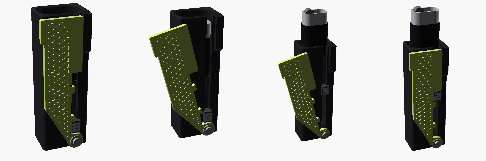

# BIC slide-out holster with lever lock (PLA)

A PLA case for a full-size BIC lighter. The lighter rides in a sliding **carriage**: push the thumb knob up and the lighter rises out of the case ready to use. Slide it back down and it is stowed below the rim. A side **lever** that pivots at the bottom locks the knob in either position.

Left to right: closed + stowed, lever open, lighter extended, closed + locked extended.

## 1. What the video shows

The reel is a CGI product animation, not a print. The overlay reads **"GRABICY · for BIC"** from the account **nokt.xyz**, and it shows a Maxi-size BIC in a black case with a green textured side lever.

Frame by frame:
1. The lever is a long, textured plate on the case's broad face. It pivots on a ringed hole at the bottom corner, and its top swings out sideways about 10–15° in the plane of the face.
2. A ribbed thumb slider runs in a vertical slot next to the lever's edge. It is attached to an inner carriage that holds the lighter.
3. **Stowed:** the lever is closed, the slider is at the bottom, and only the BIC logo shows through the top.
4. **Deploy:** open the lever, push the slider up and the lighter rises out of the top, then close the lever.
5. With the lever closed, the slider sits in a notch at the top of the lever's edge, so the lighter is held up for use. Reversing the steps stows it again.

So the lever is a **two-position lock**, not a spring launcher. When it is closed, notches in its edge trap the slider. When it is open, the slider moves freely.

I searched for the product and found no listing, patent, or printable file under "GRABICY" or "nokt". It looks like a concept render. Similar printable cases on MakerWorld and Printables are mostly friction sleeves, flip-tops and push-out-from-the-bottom designs. I found no printable slide-and-lock version, so this is an original design built around the mechanism, not a copy of the reel's shapes.

The lighter is a **Maxi (J26 / J6)**: the case is about 3× longer than wide, and the exposed lighter with its hood matches Maxi proportions.

## 2. How this design works

| Part | Role |
|---|---|
| **Body** | Rectangular tube with a solid 13 mm foot. It has a vertical knob slot in the front face that is open at the top, a pivot boss with an M3 pilot hole, a detent ridge, a closing stop block and a lanyard hole. |
| **Carriage** | A cup that holds the bottom 39 mm of the lighter, with 6 crush ribs and a push-out hole. Its stem passes through the slot to a ribbed thumb pad that sits in the same plane as the lever. |
| **Lever** | A 3.2 mm plate on an M3 screw. Its right edge has two notches made of teeth, one at the stowed knob height and one at the extended height. Its top "head" reaches over the slot and rests against the stop block. |

- **Closed:** the teeth sit above and below the thumb pad, 2.5 mm deep, so the carriage cannot move. When you press the gas fork, the force goes lighter → carriage floor → stem → pad → lower tooth → lever → M3 pivot screw.
- **Open (14°):** the teeth swing clear of the pad and it slides the full 38 mm stroke. Collision checks show everything clears once the lever is open 9° or more.
- **Removing the lighter:** with the lever open, pull the knob all the way up. The carriage leaves through the open top of the slot. Push the lighter out through the hole in the carriage floor.
- **Detent:** a vertical 0.75 mm ridge on the body clicks into one of two grooves under the lever, one for closed and one for open. That holds the lever in place without any spring that stays loaded.
- **Mid-stroke:** the lever cannot close fully unless the knob is in a notch, so you can feel when it is not locked.

### Key numbers (Maxi preset)
- Body: 34.1 × 24.1 × 102 mm. With the lever and knob ribs it is about 29 mm thick.
- Stroke: 38 mm. About 33 mm of lighter sticks out above the rim.
- **Gap from the plastic rim to the bottom of the metal hood when extended: 19 mm.** The minimum is 15 mm for PLA. The carriage top sits about 28 mm below the hood.
- When stowed, the lighter top is 5 mm below the rim and nothing touches the fork or child guard.

## 3. Design decisions
- **The lighter size is a parameter**: `lighter = "maxi" | "j6" | "slim" | "mini"`. The model stores width, thickness, corner radius and hood height for each size, and all other dimensions follow from those. **Measure your lighter with calipers** and adjust `LP` and `fit` if needed. Stickers and production batches vary by about 0.5 mm, which is what the crush ribs absorb.
- **No springs in PLA.** PLA creeps and fatigues, so nothing stays loaded at rest. The detent flexes the lever by about 0.5 mm over a 39 mm arm, which is roughly 0.15 % strain (`1.5·t·δ/L²`), far below the 1 % limit. The lever is printed flat, so it bends along the extrusion lines.
- **The thumb pad starts on the bed** (bottom of the carriage), so the stem and pad have no overhangs. Every other overhang is 45° or less: the stop block underside, the lanyard teardrop and the grip ribs.
- **The pivot is a metal screw, not a printed pin.** An M3 screw goes through a 6 mm printed boss that is 0.15 mm taller than the lever, so tightening the screw clamps the boss, not the lever, and the lever still turns freely.
- The body faces are flat (2.5 mm corner radius) so the lever lies flat. Walls are 2.4 mm, which is 6 perimeters.

## 4. Hardware
- 1 × **M3 × 12 mm** screw (button or socket head)
- 1 × **M3 large washer, DIN 9021 (9 mm OD)**. A standard 7 mm washer is too small to hold the 6.5 mm hub.
- Optional: an M3 heat-set insert instead of tapping straight into the plastic. Set `pilot_d = 4.0` and re-export.
- Optional: split ring or cord through the 3.6 mm lanyard hole.

## 5. Printing (Bambu Lab, PLA)

Global settings: 0.4 mm nozzle, 0.2 mm layers, **4 walls**, 4 top / 4 bottom layers, 25 % gyroid infill, Bambu PLA Basic profile (220 °C nozzle, 55–60 °C bed), textured PEI, elephant-foot compensation 0.15 mm, **no supports**.

| Part (STL) | Orientation | Notes |
|---|---|---|
| `stl/body.stl` | Upright, open top up, as exported | About 37 cm³, 3 h+. Use 6 walls if you have spare time. |
| `stl/carriage.stl` | Upright, open top up, as exported | Pad is on the bed. Use 100 % infill or 5 walls for a solid stem. |
| `stl/lever.stl` | Flat, texture up, as exported | Use 100 % infill (it is 3.2 mm thick). This part can be a different colour. |
| `stl/coupon_*.stl` | As exported | Quick fit tests, see §7. |

## 6. Assembly
1. Clean the slot and cavity of the body, and run a 2.5 mm drill through the pilot hole if it printed tight.
2. Push the lighter into the carriage, bottom first, until it sits on the floor. Fork and hood go to whichever side you prefer.
3. Drop the carriage into the body from the top, with the stem in the slot, and push it down to the floor.
4. Put the lever on the boss with the textured side out and the grooves facing the body. Add the DIN 9021 washer and drive the M3 × 12 screw into the pilot until the washer seats on the boss. Stop there: the lever must still swing freely.
5. Check the action: open the lever (click), push the knob up, close the lever (click). The lighter should be locked up. Do the reverse to stow it.

## 7. Test plan (print in this order)
1. **`coupon_carriage`** (14 mm, about 10 min): push the lighter bottom in. It should grip but come out by hand.
   - Too loose: raise `rib_h` (0.45 → 0.6).
   - Too tight: lower `fit` or `rib_h`.
2. **`coupon_body`** plus the carriage coupon: the carriage coupon should slide in and out without binding or rattling.
   - Adjust `sg` (0.30; try 0.2–0.4).
   - Adjust `slot_c` if the stem rubs in the slot.
3. **`coupon_pivot`**: drive the M3 screw into the block and check that the ring turns freely and does not wobble. Adjust `hub_c`, and `pilot_d` (2.4–2.6).
4. Print the **full set**, assemble it, and check:
   - Lock in both positions.
   - Pull and push on the lighter while it is locked: it should not move.
   - About 50 open/close cycles: the detent should still click.
   - Strike 10 times with the lighter extended and see whether the carriage creeps.
5. **Heat check:** burn the lighter for about 10 s while extended, then touch the rim. It must not feel warm. Never burn it longer than about 15 s.

## 8. Known risks and limits
- **Heat:** PLA softens at 55–60 °C. Do not leave the case in a hot car, on a dashboard or in direct sun. Do not run the flame for long. For hot climates, print it in **PETG or ASA** (same geometry; PETG may need `sg` +0.05).
- **Pocket ignition:** the stowed lighter is 5 mm below the rim, but a finger or key can still reach the fork through the open top. Do not carry it loose with keys.
- **Lever retention:** the detent click is gentle, about 1–2 N. If it opens too easily in a pocket, raise `ridge_p` to 0.9. Keep it at or below 1.0, or strain and wear go up.
- **Thread wear:** screwing straight into PLA wears out after many removals. Use a heat-set insert if you will take it apart often.
- **Fit varies:** lighter batches and filaments differ. Always print the coupons first.
- **Bulk:** at about 29 mm thick it is a chunky EDC item, similar to the reel.
- The reference product was not found online, so its internal design is unknown. This is an independent design that only uses the same mechanism.

## Files
- `bic-slide-holster.scad`: the parametric model. Set `part` to `body`, `carriage`, `lever`, a `coupon_*`, `closed_retracted`, `open_retracted`, `open_extended`, `closed_extended`, `exploded` or `print_layout`.
- `stl/`: printable parts and coupons. Re-export with `openscad -D 'part="body"' -o stl/body.stl bic-slide-holster.scad`.
- `renders/`: mechanism states, exploded view, per-part views and close-ups of the lock.
- `referencia/`: the source video and earlier research notes.
